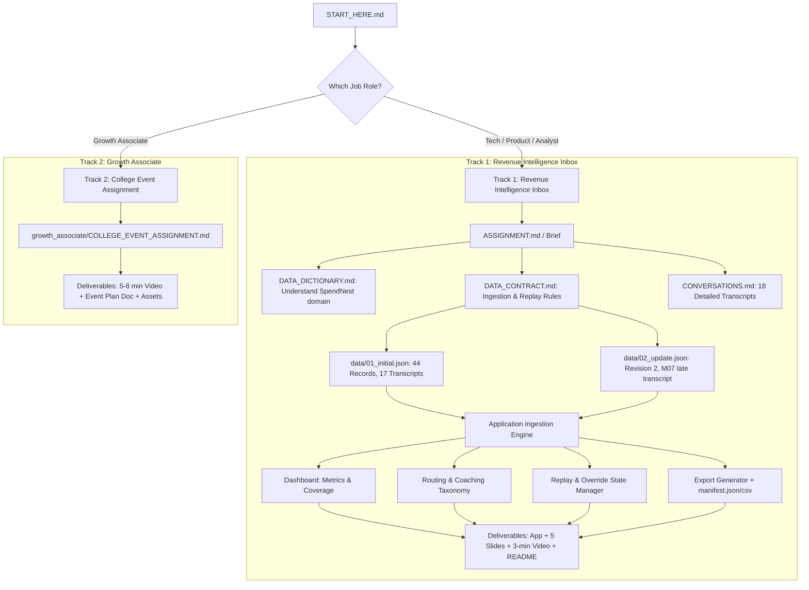

# Complete Assessment & Repository File Guide
**Role & Placement Test Context:** Recruitment assessment package for **SpendNest / OXO** (Campus / Lateral Placement Process).

This repository contains two distinct assignment tracks and all the source datasets, rules, and documentation needed to complete the evaluation.

---

## Executive Summary: What Is This Repository?

This workspace contains materials for a **placement assessment**. Depending on the exact job role you applied for, you are assigned one of two tracks:

1. **Track 1: Revenue Intelligence Inbox** (For Software Engineering, Product, Data/Analytics, or Solutions roles)
   - **Goal:** Build a working manager inbox/dashboard application that processes 44 customer interaction records (30 calls, 14 meetings) across sales, customer success, and vendor communications.
   - **Core Requirements:** Clean data ingestion, replay/update idempotency (handling revision updates without inflating counts or losing manual edits), a routing & review taxonomy, export manifests, a manager brief for 21 August 2026, 5 presentation slides, and a 3-minute narrated video walkthrough.
2. **Track 2: College Event Planning and Review** (Specifically for Growth Associate roles)
   - **Goal:** Plan, execute, and review a real or proposed college event or fest.
   - **Core Requirements:** 5–8 minute video walkthrough, event plan document/slides (budget, timeline, approvals, promotion, run-of-show, risk mitigation), and optional evidence.

> **Note:** If your placement invite is for a technical, product, or analyst position, your primary focus is **Track 1** (the root directory files). If your invite specifically says **Growth Associate**, your focus is **Track 2** (inside the `growth_associate/` folder).

---

## Complete File-by-File Breakdown

### Root Directory (Core Assignment: Revenue Intelligence Inbox)

#### 1. `START_HERE.md`
- **Purpose:** The entry point for candidates.
- **Key Contents:**
  - Explains the layout of the package.
  - Clarifies that the `growth_associate` folder is a separate assignment track.
  - Lays out the 6-step recommended reading order.
  - Clarifies that there are **44 source records** (30 calls, 14 meetings) and **18 adapted conversations** (17 in the initial batch, 1 in the update batch).
  - Explicitly states that **AI tools (ChatGPT, Copilot, etc.) are permitted** to complete the exercise.

#### 2. `ASSIGNMENT.md` / `Assignment.pdf`
- **Purpose:** The master brief and problem specification for the **Revenue Intelligence Inbox**.
- **Time & Effort:** 24-hour turnaround window from start time; expected workload is 6–8 hours.
- **Core Challenge:** Build a clickable workspace/inbox for a sales manager dealing with incoming calls, meeting transcripts, and automated CRM notes from fragmented systems.
- **The 4 Required Capabilities:**
  1. **Manager Dashboard (25 Points):** Metrics on selected-record activity (by rep/person, by type), usable transcript coverage, review queue status, and working filters. (All activity is on 21 August 2026 Asia/Kolkata).
  2. **Routing & Analysis (25 Points):** Categorize conversations into actionable destinations (e.g., Sales Coaching, Deal Next Steps, Customer Issue, Vendor/Internal Note). Must cite exact transcript turns/quotes. Includes a pre-generated or dynamic Manager Brief for 21 August 2026.
  3. **Folder & Export Structure (25 Points):** Downloadable export archive with machine-readable `manifest.json` or `manifest.csv` tracking records, applied revisions, assigned routes, file paths, and override status.
  4. **Imports, Late Transcripts & Idempotency (15 Points):** Must pass the **Replay Test**:
     - Import `01_initial.json` (44 records, 17 transcripts).
     - Re-import `01_initial.json` (Record count must stay 44; no duplicates).
     - Manually override a route (e.g., reassign meeting `M07`).
     - Import `02_update.json` (Revision 2 arrives with M07's late transcript; total records remain 44, 18 transcripts now available, and the manual override is **preserved**).
     - Re-import or refresh (manual judgment persists).
  5. **Decisions & Explanation (10 Points):** Total 100 points.
- **Deliverables Required:**
  - Working application (link or local runnable app).
  - Editable source code.
  - Generated export archive with `manifest.json` / `manifest.csv`.
  - 5-slide presentation (PPTX or PDF).
  - Short `README.md`.
  - **3-Minute continuous screen recording with spoken voice narration** demonstrating the app, a tough routing decision, and the idempotency/update replay test.
  - **3 key findings** backed by verbatim conversation citations.
  - **1 rejected decision** explaining why an alternative approach was declined.

#### 3. `DATA_CONTRACT.md`
- **Purpose:** Strict engineering specification for data ingestion, identity keys, updates, and exports.
- **Crucial Rules:**
  - **Identity:** Uniquely identified **only** by the composite key `(source_type, source_id)`. Never key by company name, contact, array index, or `record_ref` (e.g., `M07`, `C01` are just convenient human labels).
  - **Revisions:** `01_initial.json` has `revision: 1`; `02_update.json` has `revision: 2`. Newer revision completely replaces payload and transcript payload.
  - **Override Preservation:** Candidate-derived analysis, review status, and manual routing overrides must be stored separately from raw source data so newer source revisions do not wipe out human decisions.
  - **Evidence Citing Standard:**
    - For Meetings: Cite `source_id` + 1-based `turn` number (or `record_ref` + turn number, e.g., `M07 turn 3`).
    - For Calls: Cite `source_id` / `record_ref` + short exact verbatim quote (calls have no reliable turn timestamps).

#### 4. `DATA_DICTIONARY.md`
- **Purpose:** Domain glossary and schema specifications.
- **Business Context:** The simulated product is **SpendNest** (corporate spend management, vendor payouts, expense cards, reimbursement, accounting automation).
- **Domain Terms:** Defines SDR, AE, CS, CRM, Pipeline, AP/AR, ERP, KYC/KYB, and tenant access rules.
- **Important Nuance:**
  - Many calls in `01_initial.json` have `transcript: null`. This is deliberate (unconnected calls, voicemails, or adapted background records).
  - A stored upstream classification (like `is_conversation: true` or `is_connected: true`) is not ground truth; it is just upstream metadata that the manager can challenge.
  - Date rule: All activity occurs on **21 August 2026 (Asia/Kolkata)**.

#### 5. `CONVERSATIONS.md`
- **Purpose:** Complete text transcript library of all **18 adapted conversations**:
  - **10 Calls:** `C01` to `C10` (Outbound cold calls, follow-ups, gatekeepers, angry prospects, API inquiries, store expense software pitches).
  - **8 Meetings:** `M01` to `M08` (Demo calls, technical integration discussions, partnership discussions, and `M07` client bug/support review).
- **Use in Development:** Used as the ground truth text to analyze, quote, cite in findings, and test routing rules.

#### 6. `data/01_initial.json`
- **Purpose:** Primary initial data delivery file.
- **Batch Envelope:** `batch_id: "initial-001"`, `revision: 1`.
- **Contents:** Array of 44 records (30 calls: `B01`–`B20` short/unconnected + `C01`–`C10` with transcripts; 14 meetings: `M01`–`M06`, `M08`–`M14`, with `M07` delivered with `transcript_payload: null`).

#### 7. `data/02_update.json`
- **Purpose:** Secondary update data delivery file to test late-arriving data.
- **Batch Envelope:** `batch_id: "update-002"`, `revision: 2`.
- **Contents:** Contains updated record for meeting `M07` (`source_id: 4f304fff-fd40-5cfc-a366-0a134c445c2a`) with full `transcript_payload` turns now included.

#### 8. `SUBMISSION_CHECKLIST.md`
- **Purpose:** Rapid pre-submission verification checklist.
- Lists the 11 items needed for a full score (working app, source code, export files, manifest, 5 slides, README, 3-min video, 3 findings, 1 rejected decision, time spent, verify replay test).

#### 9. `index.html`
- **Purpose:** A self-contained, offline HTML reader provided by the company containing the complete assignment brief, data contract, data dictionary, and conversation library with internal jump links.

---

### Subdirectory: `growth_associate/` (Alternative Track)

#### 1. `COLLEGE_EVENT_ASSIGNMENT.md` / `College_Event_Assignment.pdf`
- **Applicable Role:** Only for **Growth Associate** candidates.
- **Objective:** Detail the planning, execution, and review of a specific college fest or event (e.g., Tech Fest, Cultural Night, E-Summit, Sports Meet).
- **Required Submissions:**
  1. **5–8 minute video walkthrough** (explaining planning to post-event review).
  2. **Event plan document/slides** (timeline, budget/resources, approvals, promotion strategy, day-of run-of-show, recording plan).
  3. **Optional supporting materials** (posters, budget sheets, photos).

---

## How the Pieces Connect Together (Architecture Diagram)

---

## How to Prompt ChatGPT / AI to Help You Complete the Work

When working with ChatGPT or coding assistants, provide clear context to get the exact output you need:

### Prompt Template 1: For the Revenue Intelligence Inbox Code (Frontend/App)
> *"I am completing a placement take-home assignment to build a 'Revenue Intelligence Inbox' for SpendNest in vanilla HTML/JS or React.
> Here are the requirements:
> - Ingest two JSON deliveries: `01_initial.json` (revision 1, 44 records) and `02_update.json` (revision 2, updates M07 with late transcript).
> - Records are uniquely keyed by `(source_type, source_id)`. Re-importing must not inflate the 44-record count.
> - Provide a manager dashboard showing activity for 21 August 2026, transcript coverage, and routing distribution.
> - Allow manual override of a conversation's assigned category, and ensure this override persists when `02_update.json` is imported.
> - Generate a downloadable export with a machine-readable `manifest.json`.
> Please generate clean, self-contained, working application code."*

### Prompt Template 2: For Conversation Routing & Manager Brief
> *"Analyze the conversations from `CONVERSATIONS.md`. Categorize each of the 18 conversations into a routing taxonomy: [Sales Coaching, Deal Next Step, Customer Support Bug, Internal/Vendor].
> For each conversation:
> 1. Give the exact route reason.
> 2. Cite the exact transcript quote or turn number as supporting evidence.
> 3. Identify ownership and next steps.
> Also create a consolidated Manager Daily Brief for 21 August 2026 highlighting top risks, coaching tips, and deal blockers."*

### Prompt Template 3: For the 5 Presentation Slides
> *"Generate content for a 5-slide placement presentation for the Revenue Intelligence Inbox project:
> Slide 1: The Manager Problem & Top 3 Findings (with exact quote citations).
> Slide 2: Interface Design Choices & What was Deliberately Left Out.
> Slide 3: Routing Architecture, Folder Structure & One Difficult Case.
> Slide 4: Data Validation, Replay Idempotency & Verification of Key Numbers.
> Slide 5: Trade-offs Accepted, 1 Deliberately Rejected Decision, AI Usage & Future Improvements."*

### Prompt Template 4: If doing the Growth Associate Track
> *"I am completing the Growth Associate placement assignment on 'College Event Planning and Review'. I am planning [Name of Event, e.g., Annual Entrepreneurship Summit / Cultural Fest] at [College Name].
> Please generate a structured, highly realistic event plan covering:
> 1. Target audience, scale, and quantified KPIs.
> 2. Pre-event timeline, budget breakdown, and administrative approvals.
> 3. Day-of-event run-of-show schedule and contingency plans.
> 4. Photography/recording shot list and post-event social media content pipeline.
> 5. Post-event ROI and metrics review."*
