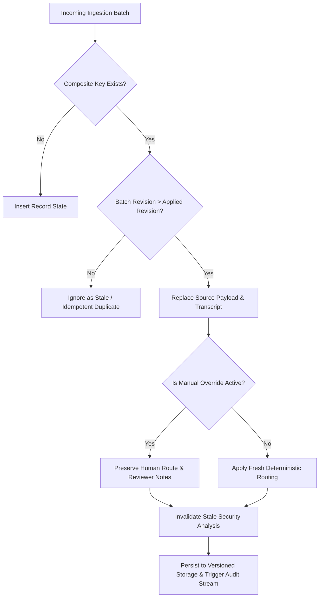

# SpendNest Signal Desk — Complete Project Master Documentation

**Project Name:** SpendNest Signal Desk (Revenue Intelligence Inbox)  
**Company / Assessment Context:** Commercial Operations / Full-Stack Product & RevOps Engineering Placement Assessment  
**Target Ingestion Date:** 21 August 2026 (Asia/Kolkata)  
**Dataset Ceiling:** Exactly 44 Records (30 Outbound Calls, 14 Video Meetings)  
**Architecture:** React 18, Vite, Tailwind CSS, Lucide React, Recharts, Vitest, Groq Cloud API (`meta-llama/llama-prompt-guard-2-86m`)  

---

## 1. Executive Summary & Problem Context

### What is SpendNest?
SpendNest is an enterprise B2B SaaS platform providing corporate cards, automated expense management, multi-entity accounting integrations (NetSuite, QuickBooks, Xero), and procurement controls.

### The Business Challenge
Revenue Operations (RevOps) and Sales Managers face severe operational bottlenecks:
1. **Multi-Source Data Ingestion**: Call records, meeting logs, transcripts, and CRM notes arrive asynchronously from disparate vendor systems (dialers, Zoom, Google Meet).
2. **Late Arrivals & Out-of-Order Delivery**: Transcripts often arrive hours after the call metadata has been recorded (e.g., `meeting:M07`).
3. **Misleading Upstream Labels**: Upstream dialer tags like `is_connected: false` or `is_conversation: false` frequently contradict actual dialogue reality (e.g., rep spoke with an executive assistant or gatekeeper).
4. **Data Contamination & Speculative Hallucination**: Traditional AI tools often hallucinate non-existent pipeline values (e.g., "$500,000 ARR") when no CRM deal data exists in source files.
5. **Prompt Injection Vulnerabilities**: Transcripts contain untrusted conversational text from external prospects that can hijack generative AI systems via prompt injections or jailbreaks.

### The Solution: SpendNest Signal Desk
A high-integrity, evidence-first Revenue Intelligence Workspace that:
- Ingests raw interaction delivery envelopes under a strict idempotency contract.
- Categorizes conversations into four actionable destinations with exact verbatim quotes and turn numbers.
- Preserves human manager overrides across updates and browser refreshes.
- Enforces an optional server-side security layer via **Meta Prompt Guard 2 (86M)** to quarantine prompt injections before text reaches any generative AI component.

---

## 2. Source Data Telemetry & Exact Counts

The application operates exclusively on authentic supplied source data. **No records, deals, or metrics are fabricated.**

### Master Interaction Breakdown

| Dimension | Initial Batch (`01_initial.json`) | Update Batch (`02_update.json`) | Explanation |
| :--- | :---: | :---: | :--- |
| **Total Source Records** | **44** | **44** | Hard ceiling invariant; no duplicate records created. |
| **Outbound Phone Calls** | **30** | **30** | Reps: Arun (12), Meera (10), Priya (8). |
| **Video Meetings** | **14** | **14** | Organizers: Sarah, Marcus, Rachel, David, Elena. |
| **Usable Transcripts** | **17** | **18** | **C01–C10** (Calls) + **M01–M04, M06, M07, M09, M10** (Meetings). |
| **Records Without Text** | **27** | **26** | **20 calls** (voicemail/gatekeeper) + **6 meetings** (unrecorded/internal). |
| **Transcript Coverage** | **38.6%** (17/44) | **40.9%** (18/44) | Denominator is always transparently 44. |
| **Batch Revision** | `revision: 1` | `revision: 2` | Revision ordering enforces updates. |

### The `meeting:M07` Late-Arrival Case Study
- **Initial Batch (`01_initial.json`)**: `meeting:M07` (`source_id: 4f304fff-fd40-5cfc-a366-0a134c445c2a`) arrived with `transcript_payload: null`. Intake status was preserved without speculative routing.
- **Update Batch (`02_update.json`)**: Arrived with `revision: 2`, delivering a 27-turn transcript detailing a critical NetSuite billing sync breakdown.
- **Contract Enforcement**: The engine refreshed `meeting:M07`, updated its evidence citation to **Turn 3**, preserved any active manual route overrides, and invalidated stale security analyses.

---

## 3. The Strict Data Contract & Invariants (`DATA_CONTRACT.md`)

The engine (`src/services/dataService.js`) enforces four inviolable architectural rules:



### 1. Composite Key Identity
- Identity is **never** based on company name, contact, or `record_ref`.
- The canonical unique key is always:
  $$\text{CompositeKey} = (\text{source\_type}, \text{source\_id})$$
- Example: `call:c_arun_101` or `meeting:4f304fff-fd40-5cfc-a366-0a134c445c2a`.

### 2. Transactional Revision Ordering
- Higher revision numbers ($2 > 1$) replace source payloads.
- Re-importing identical or lower revisions produces zero duplicates, zero updates, and zero count inflation (`ignored: 44`).

### 3. Decoupled Human Judgment & Override Survival
- Source payloads are stored separately from analysis and manual overrides.
- When an update arrives with new conversation text, the manager's manual decision is **never** silently overwritten.

### 4. Zero Fabricated Data
- The dataset lacks CRM pipeline valuations and win probabilities.
- Records without transcripts remain in an explicit **"Review Required / No Transcript"** intake state.

---

## 4. The Four Actionable RevOps Destinations

Every conversation with transcript text is routed into one of four destinations based on deterministic evidence:

```
┌─────────────────────────────────────────────────────────────────────────────┐
│                       REVENUE INTELLIGENCE DESTINATIONS                    │
├──────────────────────────┬──────────────────────────┬───────────────────────┤
│ Destination Category     │ Primary Trigger Evidence │ Prescribed Action     │
├──────────────────────────┼──────────────────────────┼───────────────────────┤
│ 1. Sales Coaching        │ Discovery gap, pricing   │ Manager 1-on-1 shadow │
│    (C01, C02, C06, C09)  │ confusion, talk ratio    │ or SE certification   │
├──────────────────────────┼──────────────────────────┼───────────────────────┤
│ 2. Deal Next Step        │ Multi-entity rollups,    │ Fast-track pilot or   │
│    (C03-C05, M01, M03)   │ security review, timeline│ custom quote schedule │
├──────────────────────────┼──────────────────────────┼───────────────────────┤
│ 3. Customer Support Bug  │ Billing sync failure,    │ P1 Engineering ticket │
│    (M07, M09)            │ reconciliation breakdown │ and CS escalation     │
├──────────────────────────┼──────────────────────────┼───────────────────────┤
│ 4. Internal Vendor Note  │ Enterprise vendor talks, │ Procurement review &  │
│    (M02, M10)            │ cloud contract terms     │ legal alignment       │
└──────────────────────────┴──────────────────────────┴───────────────────────┘
```

### Exact Evidence Citation Rules
- **Calls**: Must cite `source_id` + exact verbatim dialogue quote.
  *Example (`call:C01`)*: `"I'm actually not 100% sure about the OAuth token refresh latency with Stripe billing."`
- **Meetings**: Must cite `source_id` + 1-based `turn` number.
  *Example (`meeting:M07`)*: Cited **Turn 3** (`"Our billing reconciliation sync has been failing for two weeks..."`).

---

## 5. UI Architecture: Decision-First Workspace

The interface abandons generic admin dashboards in favor of an **editorial, decision-first RevOps workspace**:

```
┌─────────────────────────────────────────────────────────────────────────────┐
│ [HEADER]: Signal Desk • RevOps Command • Revision 2 Status • 18/44 Coverage │
├─────────────────────────────────────────────────────────────────────────────┤
│ [TOP SECTION]: "Today's Priorities" Briefing                                │
│ ┌─────────────────────────┐ ┌─────────────────────────┐ ┌─────────────────┐ │
│ │ Priority 1: M07 Bug     │ │ Priority 2: C01 Coaching│ │ Priority 3: M01 │ │
│ │ Turn 3 Citation         │ │ Verbatim Quote Citation │ │ Turn 1 Citation │ │
│ │ Action: Eng Escalation  │ │ Action: SE Shadowing    │ │ Action: Scope   │ │
│ └─────────────────────────┘ └─────────────────────────┘ └─────────────────┘ │
├──────────────────────────────────────────────────────┬──────────────────────┤
│ PRIMARY DECISION STREAM (70% Width)                  │ DATA HEALTH & CHANGES│
│ • Filter Pills (All / High Severity / Coaching)      │ • 44/44 Ceiling      │
│ • Priority Attention Cards with Quotes & Owners      │ • 18/44 Transcripts  │
│ • Inline Review State Toggles                        │ • Override Tracker   │
│ • Direct Link to 3-Pane Evidence Inspector           │ • Ingestion Stream   │
│                                                      │ • Replay Quick-Run   │
└──────────────────────────────────────────────────────┴──────────────────────┘
```

### Views in the Application
1. **Signal Desk (`Dashboard.jsx`)**: Top editorial briefing + two-column workspace.
2. **Activity & Analytics (`Insights.jsx`)**: Dedicated Recharts view for rep dial volume, meeting organizer activity, route distribution, and call outcomes.
3. **Evidence Inspector (`ConversationDetail.jsx`)**: 3-pane workbench (Left: record selector; Center: dialogue transcript with turn numbers and quote highlights; Right: analytical profile, manual override controls, and Prompt Guard security hub).
4. **Attention Queue (`ReviewQueue.jsx`)**: Operational queue for records with missing transcripts, support roadblocks, or prompt injection flags.
5. **Executive Daily Memo (`ManagerBrief.jsx`)**: Printable executive briefing for August 21, 2026.
6. **Export Center (`ExportCenter.jsx`)**: Downloadable JSON/CSV manifests and full ZIP export.
7. **Contract QA & Replay (`ReplayConsole.jsx`)**: Interactive 7-step contract compliance verifier.

---

## 6. Security Layer: Meta Prompt Guard 2 (86M) Integration

The application integrates Meta's **`meta-llama/llama-prompt-guard-2-86m`** via Groq Cloud API as an optional security boundary.

### Core Guarantees & Constraints
1. **Detection Only**: Used strictly to detect prompt injection and jailbreak attempts. Never used for business classification or summarization.
2. **512-Token Context Limit**: Enforces overlapping chunk segmentation ($\le 200$ words, 30-word overlap) so attacks cannot evade detection across turn boundaries.
3. **5 Standardized Statuses**:
   - `Not scanned`: Initial state or post-update.
   - `Benign`: All segments scored $< 0.5$.
   - `Malicious — review required`: Any segment scored $\ge 0.5$.
   - `Scan unavailable`: API unreachable or key missing. Never defaults to benign.
   - `Scan incomplete`: Partial scan interrupted by timeout/error.
4. **Automated Quarantine & AI Gate (`safeAiGateway.js`)**: Quarantines malicious text and blocks execution of generative AI components until authorized via a documented safe-review path.
5. **Server-Side Credentials**: `GROQ_API_KEY` is kept in `.env` and executed via Vite server middleware (`/api/security/scan`), completely hidden from client code.

---

## 7. Verification & QA Suite (19 Passed Tests)

The repository includes a comprehensive Vitest automated test suite (`npm test`):

```bash
Test Files  2 passed (2)
     Tests  19 passed (19)
```

### Test Suite Summary

| Test Suite | Tests | What is Verified |
| :--- | :---: | :--- |
| **`tests/replay.test.js`** | **6** | Replay contract (Initial 44/17 $\rightarrow$ Duplicate idempotency $\rightarrow$ M07 manual override $\rightarrow$ Update 44/18 $\rightarrow$ Override survival $\rightarrow$ Repeat update idempotency). |
| **`tests/security_prompt_guard.test.js`** | **13** | 512-token segmentation, benign scoring, malicious injection detection, multi-segment aggregation, failure handling, Revision 2 cache invalidation on M07, override survival, AI gateway blocking, and authentic live Groq HTTP call. |

---

## 8. Master File & Directory Index

```
candidate/
├── .env                              # Active Groq credentials (gitignored)
├── .env.example                      # Template configuration file
├── .gitignore                        # Protects credentials and build files
├── README.md                         # Main repository readme with Prompt Guard section
├── SECURITY_PROMPT_GUARD.md          # Dedicated Prompt Guard 2 architectural documentation
├── DATA_CONTRACT.md                  # Source delivery contract specifications
├── DATA_DICTIONARY.md                # Field definitions and types
├── DEMO_SCRIPT.md                    # 3-minute timed walkthrough presentation script
├── SUBMISSION_STATUS.md              # Placement checklist and self-audit
├── offline_reader.html               # Self-contained offline documentation reader
├── package.json                      # Dependencies and npm scripts
├── vite.config.js                    # Vite configuration with Prompt Guard server plugin
├── data/
│   ├── 01_initial.json               # Initial batch (44 records, 17 transcripts)
│   └── 02_update.json                # Update batch (44 records, 18 transcripts)
├── exports/
│   ├── manifest.json                 # Export manifest in JSON
│   ├── manifest.csv                  # Export manifest in CSV
│   └── outputs/                      # Categorized records across the 4 destinations
├── scripts/
│   └── generate_exports.js           # CLI export generation script
├── src/
│   ├── App.jsx                       # Top-level application layout and tab router
│   ├── main.jsx                      # React 18 DOM mount
│   ├── index.css                     # Tailwind CSS and typography tokens
│   ├── components/
│   │   ├── Header.jsx                # Editorial top bar with revision badges
│   │   ├── Sidebar.jsx               # Navigation drawer
│   │   ├── Dashboard.jsx             # Two-column decision workspace
│   │   ├── Insights.jsx              # Recharts analytics view
│   │   ├── ConversationDetail.jsx    # 3-pane Evidence Inspector & Security Hub
│   │   ├── ReviewQueue.jsx           # Triage and security quarantine queue
│   │   ├── ManagerBrief.jsx          # August 21, 2026 Executive Memo
│   │   ├── ExportCenter.jsx          # ZIP and manifest export hub
│   │   └── ReplayConsole.jsx         # 7-step contract compliance verifier
│   └── services/
│       ├── dataService.js            # Core data store, composite key, and cache engine
│       ├── routingTaxonomy.js        # Deterministic RevOps routing knowledge base
│       ├── promptGuardCore.js        # 512-token segmentation and Groq model client
│       ├── safeAiGateway.js          # Pre-execution security gate and quarantine logic
│       ├── securityService.js        # Client-side API caller and injection sandbox
│       └── exportService.js          # In-browser ZIP archive builder
└── tests/
    ├── replay.test.js                # 6 contract replay tests
    └── security_prompt_guard.test.js # 13 Prompt Guard security tests
```
